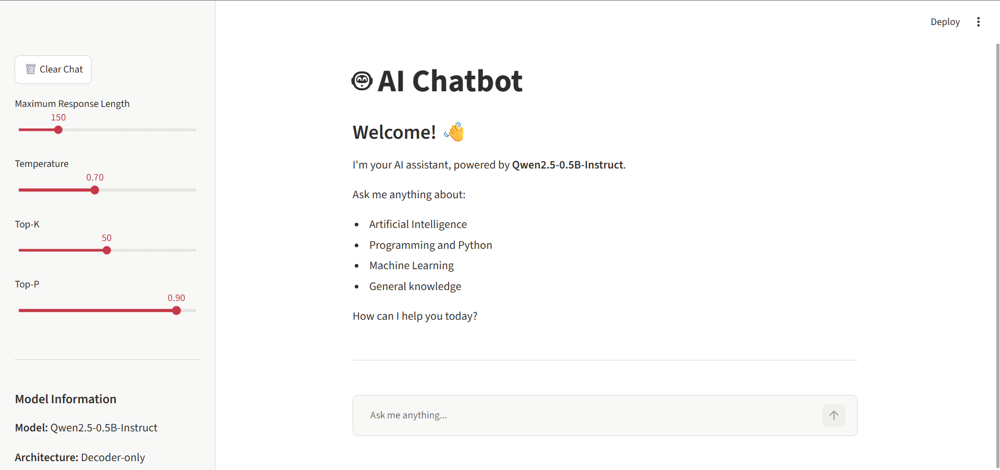

## Application Screenshot




# AI Chatbot Using Hugging Face

An interactive AI chatbot built using **Qwen2.5-0.5B-Instruct**, Hugging Face Transformers, PyTorch and Streamlit.

## Overview

This project implements a conversational AI assistant that generates responses using a pretrained instruction-tuned Large Language Model (LLM).

## Tech Stack

- Python
- Hugging Face Transformers
- Qwen2.5-0.5B-Instruct
- PyTorch
- Streamlit

## Features

- Interactive chatbot interface
- Context-aware conversation history
- Adjustable response length
- Temperature, Top-K and Top-P controls
- Clear chat functionality
- Download chat history
- Loading indicator and error handling

## Project Structure

```text
AI_Chatbot/
├── app.py
├── chatbot.py
├── requirements.txt
├── README.md
├── .gitignore
└── screenshots/
    └── chatbot.png
```

## Installation

Clone the repository:

```bash
git clone https://github.com/YOUR_USERNAME/AI-Chatbot-Using-HuggingFace.git
```

Navigate to the project:

```bash
cd AI-Chatbot-Using-HuggingFace
```

Create a virtual environment:

```bash
python -m venv venv
```

Activate it on Windows:

```bash
venv\Scripts\activate
```

Install dependencies:

```bash
pip install -r requirements.txt
```

## Run the Application

```bash
streamlit run app.py
```

## Model Information

**Model:** Qwen/Qwen2.5-0.5B-Instruct

The chatbot uses an instruction-tuned decoder-only Transformer model for conversational text generation.

## Future Improvements

- Retrieval-Augmented Generation (RAG)
- PDF-based question answering
- Conversation summarization
- Improved response streaming

